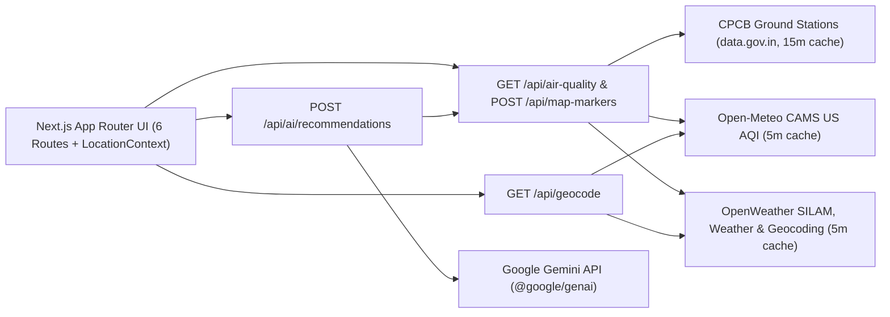

# AirWise AI

**Real-time multi-standard air quality intelligence and Gemini-powered family action plans for severe winter smog and urban air pollution.**


> **Prompt Wars Challenge 6 Submission**  
> **Live Demo:** *(To be added after deployment)* &nbsp;|&nbsp; **Demo Video:** *(To be added once recorded)*

---

## Problem & Solution

**The Problem:** Families, children, older adults, and commuters living through severe winter smog and urban air pollution often face confusing, conflicting AQI numbers across apps, blurred regional scales, and generic advice disconnected from their household's daily routine or budget.

**The Solution:** **AirWise AI** combines official ground-station monitoring in India (CPCB), global modeled AQI (Open-Meteo Copernicus CAMS), atmospheric pollutant/weather telemetry (OpenWeather), and server-grounded **Google Gemini** guidance inside a responsive Atmospheric Liquid Glass web app. It translates verified local air conditions into practical, low-emission daily routines, affordable indoor air protection, and transparent commute emission trade-offs—without fabricating readings, averaging incompatible AQI scales, or making unsupported medical claims.

---

## Six Core Features

1. **Multi-Standard Live Dashboard (`/`)** — Prioritizes fresh official **India CPCB IND-NAQI (0–500)** ground stations when within 25 km, displays independent **US EPA AQI (0–500+, Open-Meteo modeled)** and **OpenWeather (1–5, SILAM modeled)** badges separately, and includes pollutant concentration cards, expandable sub-indices, nearest-station info, and a 24-hour trajectory chart.
2. **Interactive Global Map (`/global-map`)** — Leaflet map on authenticated **CARTO Dark Matter** tiles with strictly separated **`US AQI (0–500)`**, **`India CPCB`**, and **`OW (1–5)`** tabs, optional surface wind vectors, and **`Select Location`** click/tap + keyboard **`Coordinates`** entry to inspect any point worldwide and sync it across the app.
3. **Gemini AI Atmospheric Advisor (`/gemini-ai`)** — Personalized Q&A and priority action cards tailored to activity, commute mode, household profile, and constraints.
4. **Pollution-Aware Daily Routine (`/daily-routine`)** — Structured **Morning**, **Afternoon**, and **Evening** plans highlighting safer timing windows and low-emission adjustments, explicitly tagged by data basis (`Provider 24h Forecast`, `Current Observed`, or `General Guidance`).
5. **Indoor Air Rescue (`/indoor-air-rescue`)** — Zero-cost and budget-conscious indoor steps (timed cross-ventilation, wet mopping, lid-covered cooking, draft sealing, DIY Corsi-Rosenthal box fans, and HEPA filtration) paired with an explicit disclosure that outdoor AQI does not measure indoor air quality.
6. **What-If Transport Simulator (`/what-if-simulator`)** — Deterministic TypeScript CO₂e comparisons across solo driving, carpooling (2–5 riders), bus, metro/rail, cycling, and walking using UK DESNZ / DEFRA 2024 factors, paired with a Gemini explainer that clearly separates personal CO₂e savings from city-wide AQI changes.

---

## System Architecture



---

## How Gemini Powers the Four AI Modules

All four modules (`advisor`, `daily-routine`, `indoor-rescue`, `what-if`) route through a single server-only handler (`POST /api/ai/recommendations`) using the official `@google/genai` SDK:

- **Server-Verified Grounding:** Re-fetches verified CPCB, Open-Meteo, and OpenWeather telemetry directly on the server rather than trusting client-supplied numbers, passing explicit `IND_CPCB` vs. `US_EPA` standard metadata so thresholds are never confused.
- **Structured Output & Validation:** Enforces `responseMimeType: "application/json"` with strict per-mode `responseSchema` and validates every response via `validateAiRecommendationPayload()` before rendering.
- **Safety & Reliability Safeguards:** Untrusted inputs are sanitized, length-bounded, and wrapped inside `<UNTRUSTED_USER_INPUT>` tags. Requests enforce an 8 KB body cap, sliding-window rate limits, disabled SDK retry loops (`attempts: 1`), a 22-second `AbortController` deadline, at most one bounded `503` retry (`1.5 s`), and client-side concurrency/cooldown protection.

---

## Tech Stack & Data Providers

| Layer | Technology / Provider | Role & Standard |
| --- | --- | --- |
| **Framework & UI** | Next.js 16 (App Router, Webpack), React 19, TypeScript, Tailwind CSS v4 | Responsive Atmospheric Liquid Glass UI & server Route Handlers |
| **Mapping** | Leaflet (`ssr: false`) + CARTO Dark Matter | Interactive markers, custom pin selection, surface wind arrows |
| **India Ground AQI** | **CPCB via `data.gov.in`** (`3b01bcb8-0b14-4abf-b6f2-c1bfd384ba69`) | Official **IND-NAQI (0–500)** 6-band sub-indices from ~568 stations |
| **Global / Fallback AQI** | **Open-Meteo Air Quality API** (Copernicus CAMS) | Modeled **US EPA AQI (0–500+)**, sub-indices & 24h forecast |
| **Pollutants & Weather** | **OpenWeather API** (SILAM, Weather, Geocoding) | Modeled 1–5 index, µg/m³ pollutants, wind/temp/humidity, reverse geocode |
| **Generative AI** | **Google Gemini** (`@google/genai`) | Structured JSON advisory across all 4 lifestyle modules |
| **Emissions Factors** | UK DESNZ / DEFRA 2024 Conversion Factors | Deterministic `g CO₂e / passenger-km` commute math |

---

## CPCB Coverage Policy & Limitations

AirWise AI matches coordinates to the nationwide CPCB snapshot using Haversine distance (never exact city-name matching) and enforces CPCB's official validity rule (≥ 3 valid pollutants including PM2.5 or PM10, reading ≤ 3 hours old, preserving valid `0` sub-indices while rejecting `"NA"`):

- **≤ 10 km:** Official CPCB station AQI is shown as primary.
- **10–25 km:** Official CPCB station AQI is shown as primary with an explicit distance disclosure badge.
- **25–50 km:** Open-Meteo US AQI remains primary; the nearest valid CPCB station is shown strictly as a **Regional Reference** (never as exact local AQI).
- **> 50 km or Outside India:** Open-Meteo US AQI is shown as primary with clear fallback reasons (`no_nearby_station`, `station_stale`, `insufficient_pollutants`, or `provider_unavailable`).

**Key Limitations:** Many tier-2/rural Indian cities lack active CAAQMS stations (e.g., Warangal, Karimnagar, Khammam, and Nizamabad fall back to Open-Meteo). The `data.gov.in` feed publishes CPCB sub-indices rather than raw `µg/m³` concentrations, so the 2×2 concentration cards remain sourced from OpenWeather (explicitly labeled Modeled). No physical indoor sensors are connected, and in-memory rate limits/caches reset across serverless cold starts.

---

## Verified Quality Metrics

- **Automated Tests (`npm test`):** **29/29 passing** across 10 suites (CPCB distance-tier policies, >4,000-row pagination, valid-zero handling, 2024 EPA PM2.5 breakpoints, Map→Dashboard cache isolation, deterministic CO₂e math, all 4 Gemini schemas, error classification, and rate limiting).
- **Static & Build Checks:** `npm run lint` (`0` errors/warnings), `npx tsc --noEmit` (`0` errors), and `npm run build` (`next build --webpack`) all pass cleanly.
- **Security:** `0` reported production dependency vulnerabilities (`npm audit --omit=dev`), `0` private API keys in generated client bundles, and CSP + security headers configured in `next.config.ts`.
- **Accessibility & Lighthouse (Production Build):** Scored **100** in Lighthouse Accessibility, Best Practices, and SEO across tested desktop and mobile production runs (`/`, `/global-map`, `/gemini-ai`), with semantic landmarks, keyboard `LocationModal` trapping, coordinate-entry map fallback, and `sr-only` chart summaries. *(Lighthouse scores do not by themselves guarantee full WCAG 2.2 AA conformance or optimal mobile performance on all hardware.)*

---

## Local Setup & Environment Variables

**Prerequisites:** Node.js 20+ and npm 10+.

```bash
git clone https://github.com/harshithgutam-rgb/promptwars-demo-6.git
cd promptwars-demo-6
npm install
cp .env.example .env.local
# Add your keys in .env.local (never commit .env.local)
npm run dev
```

Open `http://localhost:3000`. Run checks with `npm test`, `npm run lint`, `npx tsc --noEmit`, and `npm run build`.

| Variable | Scope | Required | Placeholder / Purpose |
| --- | --- | --- | --- |
| `OPENWEATHER_API_KEY` | Server-only | Yes | `your_openweather_api_key_here` — Air Pollution, Weather & Geocoding |
| `DATA_GOV_IN_API_KEY` | Server-only | Optional | `your_data_gov_in_api_key_here` — India CPCB stations (falls back to Open-Meteo if unset) |
| `GEMINI_API_KEY` | Server-only | Yes (AI) | `your_gemini_api_key_here` — Server-side `@google/genai` recommendations |
| `GEMINI_MODEL` | Server-only | Optional | `gemini-3.5-flash-lite` — Overrides default `gemini-3.1-flash-lite` |
| `NEXT_PUBLIC_CARTO_BASEMAP_KEY` | Browser | Yes (Map) | `your_carto_basemap_key_here` — CARTO Dark Matter tiles (domain-restrict in CARTO) |

**Vercel Deployment:** Configure the environment variables above in Vercel Project Settings, set Build Command to `npm run build` (`next build --webpack`), Output Directory to `.next`, and restrict `NEXT_PUBLIC_CARTO_BASEMAP_KEY` to your deployment domain.

---

## Judge Demonstration Workflow (90 Seconds)

1. **Dashboard (`/`, New Delhi):** Show official **India AQI (CPCB)** from the nearest ground station alongside separate **US AQI (Modeled)** and **OpenWeather (1–5)** badges, expandable sub-indices, nearest-station info, and the 24-hour trajectory chart.
2. **Global Map (`/global-map`):** Switch across **`India CPCB`**, **`US AQI (0–500)`**, and **`OW (1–5)`** tabs to inspect separate legends; enable **`Select Location`** (or keyboard **`Coordinates`**) to tap a town without a CPCB station (e.g., Warangal) and confirm honest Open-Meteo fallback plus **`View Full Dashboard`** / **`AI Recommendations`** sync.
3. **Smog-Aware Family Plans (`/daily-routine` & `/indoor-air-rescue`):** Generate a Morning/Afternoon/Evening routine and review zero-cost/affordable indoor air steps with the explicit outdoor ≠ indoor disclosure.
4. **Emissions Trade-Offs (`/what-if-simulator`):** Compare solo driving vs. metro/carpool to show deterministic weekly/annual CO₂e savings alongside Gemini's exposure trade-off explanation.

---

## Data Attribution & Licensing

- **India CPCB Stations:** [Central Pollution Control Board](https://cpcb.nic.in/) via [data.gov.in](https://data.gov.in/) — **Government Open Data License - India (GODL)**.
- **Global Modeled US AQI:** [Open-Meteo.com](https://open-meteo.com/) (Copernicus CAMS) — **CC BY 4.0**.
- **Pollutants, Weather & Geocoding:** [OpenWeather](https://openweathermap.org/).
- **Basemap & Map Engine:** `© OpenStreetMap contributors`, Dark Matter tiles `© CARTO`, rendered with [Leaflet](https://leafletjs.com/) (BSD-2-Clause).
- **Emissions Factors:** UK DESNZ / DEFRA 2024 Greenhouse Gas Reporting Conversion Factors.
